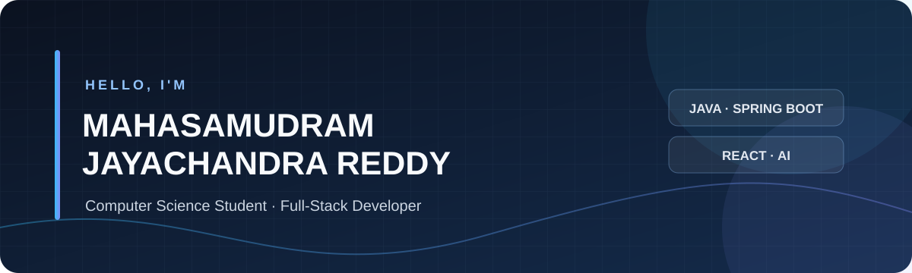

# MAHASAMUDRAM JAYACHANDRA REDDY

### Computer Science & Engineering Student · Full-Stack Developer

Building practical applications with **Java, Spring Boot, React, and AI integration**.

 

---

## 👋 About Me

I'm a Computer Science and Engineering student at **Koneru Lakshmaiah Education Foundation (KL University)**. I enjoy building useful software, learning how real-world systems work, and improving my problem-solving skills.

- 🎓 B.Tech in Computer Science and Engineering · 2024–2028
- 💻 Interested in full-stack development and backend engineering
- ☕ Building with Java, Spring Boot, React, and relational databases
- 🧠 Exploring AI-powered applications and retrieval-based systems
- 🎯 Focused on writing better code and turning ideas into working projects

---

## 🧰 Tech Stack

**Languages**

**Frontend**

**Backend & Data**

**Tools**

---

## 🚀 Featured Projects

<table>
<tr>
<td width="50%" valign="top">

### 01 · SupportIQ

**AI-Powered Customer Support Platform**

A multi-tenant support platform that helps businesses answer customer questions using their own knowledge documents and escalate conversations to human agents when needed.

- Document ingestion and knowledge-based retrieval
- Tenant-scoped question answering
- Customer chat and human-agent escalation
- Analytics and subscription-related features

**Stack:** React · Spring Boot · PostgreSQL · pgvector · WebSockets

[**Explore SupportIQ →**](https://github.com/yme2096/SupportIQ)

</td>
<td width="50%" valign="top">

### 02 · ApplyPilot

**Job Application Management Platform**

A platform for organizing job applications and managing resume-related workflows.

- Resume upload and document parsing
- Job application workflow management
- Backend APIs and database migrations
- Redis integration and Docker Compose setup

**Stack:** Java 21 · Spring Boot · React · PostgreSQL · Redis · Docker

[**Explore ApplyPilot →**](https://github.com/yme2096/ApplyPilot)

</td>
</tr>
<tr>
<td width="50%" valign="top">

### 03 · VetAssist

**Veterinary Assistance Platform**

A platform designed to help farmers organize animal health information and connect with veterinary support.

- Farmer, veterinarian, and administrator roles
- Animal record management
- Guided symptom intake and emergency screening
- Veterinarian discovery and consultation workflows

**Stack:** React · Spring Boot · PostgreSQL · JWT · Docker

[**Explore VetAssist →**](https://github.com/yme2096/VetAssist)

</td>
<td width="50%" valign="top">

### 04 · ShopSmart AI

**E-commerce Application**

A full-stack e-commerce project with a React frontend and Node.js backend.

- Product and shopping workflows
- Backend API integration
- Authentication and payment-related integration

**Stack:** React · Node.js · Express · MongoDB

[**Explore ShopSmart AI →**](https://github.com/yme2096/shopsmart-ai)

</td>
</tr>
<tr>
<td width="50%" valign="top">

### 05 · Realtime Chat App

**Real-Time Communication Application**

A chat application built around real-time messaging and communication features.

- Real-time events with Socket.IO
- React-based client interface
- Backend services and database integration

**Stack:** React · Node.js · Express · Socket.IO · MongoDB · Redis

[**Explore Realtime Chat App →**](https://github.com/yme2096/realtime-chat-app)

</td>
<td width="50%" valign="top">

### 06 · CinePass

**Movie Ticket Booking Platform**

A project focused on the movie discovery and ticket booking experience.

[**Explore CinePass →**](https://github.com/yme2096/CinePass-Movie-Ticket-Booking-Platform.)

</td>
</tr>
</table>

---

## 🎓 Education

**Koneru Lakshmaiah Education Foundation (KL University)**

B.Tech · Computer Science and Engineering

2024 – 2028

---

## 📌 What I'm Working On

- Strengthening Java and Data Structures & Algorithms
- Improving backend development with Spring Boot
- Building and refining full-stack applications
- Learning databases, Docker, and cloud deployment
- Exploring practical AI integration

---

## 📊 GitHub Activity

---

### Thanks for visiting!

Feel free to explore my repositories and follow my learning journey.

